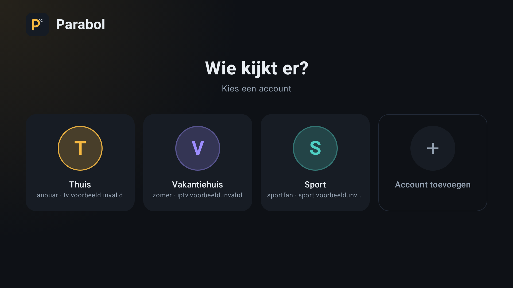
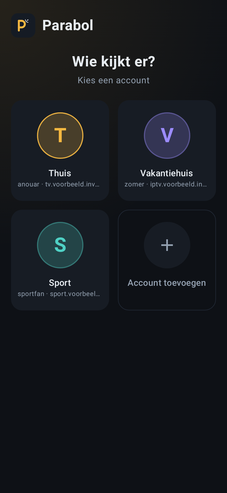
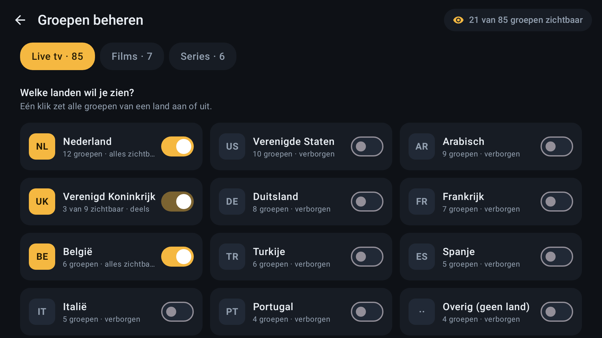
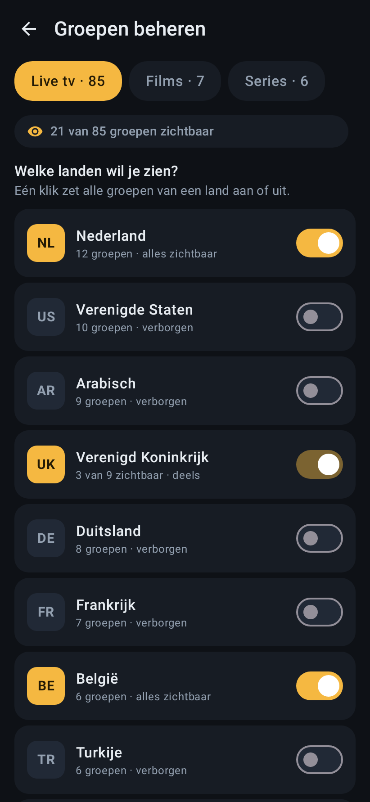

# Wijzigingen (Android)

## Nieuw in v2.5.1

- Ondertekend met een nieuwe vaste sleutel. Eenmalig: verwijder de oude Parabol en installeer deze versie.

## Nieuw in v2.5.0

- **Menugrootte op tv**: in Instellingen kies je Klein, Normaal of Groot. Normaal is kleiner dan voorheen, zodat de menu's minder ingezoomd ogen.
- **Instellingen helemaal bereikbaar met de afstandsbediening**: onderaan staat nu **Over Parabol**, met het versienummer en de schermgegevens.
- Klaar voor Google Play: gebouwd voor Android 16 (API 36), schermvullende weergave op nieuwe telefoons, en naast de APK een App Bundle (.aab).

## Nieuw in v2.4.4

- De app is vanaf nu ondertekend met één vaste sleutel (geregistreerd bij Google). Eenmalig: verwijder de oude Parabol en installeer deze versie; daarna gaan updates gewoon over de bestaande installatie heen.

## Nieuw in v2.4.3

- De geselecteerde tegel wordt op tv niet meer aan de bovenkant afgesneden, en de focusmarkering volgt de ronde hoeken.
- Live tv: in het voorbeeldscherm ga je met de afstandsbediening omlaag door de programma's die hierna komen; het scherm scrolt mee. Kies er een om de tv-gids te openen.

## Nieuw in v2.4.2

- **Menu's passen op elke tv.** Sommige Google TV-toestellen (vaak 4K) melden een kleiner scherm, waardoor de bediening ingezoomd leek: de bovenste tegel op Home viel weg, de tv-gids was te groot en Instellingen paste niet. Parabol schaalt de bediening op tv nu altijd zelf naar 960×540 en begrenst vergrote systeemtekst.
- Onderaan Instellingen staan de schermgegevens van het toestel, handig bij weergaveproblemen.

## Nieuw in v2.4.1

- De accountkeuze toont alleen de naam van elk account; bij inloggen en toevoegen is de naam verplicht.
- **Ondertiteling uit de film zelf**: zit er ondertiteling in het bestand (bijv. in een .mkv), dan kies je die in de speler. Op de computer staat bovenin een keuzelijst ("Ondertiteling uit", "Nederlands", "Engels" …); op Android via de ondertitelknop (CC) van de speler. Een spoor dat het bestand als standaard markeert, staat meteen aan. Eigen .srt-bestanden en OpenSubtitles blijven werken.

## Nieuw in v2.4.0

- Parabol start nu **altijd** op de accountkeuze, ook met één account. Zo kies je zelf wanneer je een account opent, en is **Account toevoegen** altijd binnen handbereik.
- De instelling **Tijdcorrectie tv-gids** is verwijderd; de gids gebruikt de tijden van je aanbieder.

## Nieuw in v2.3.0: accountkeuze

Heb je meer dan één account, dan opent Parabol op **"Wie kijkt er?"**: een tegel per account met de naam, de gebruikersnaam en de server, plus **Account toevoegen**. Kies een account en je komt op Home zoals je gewend bent; met terug ga je weer naar de accountkeuze. Bij inloggen en toevoegen geef je het account een eigen naam (bijvoorbeeld "Thuis" of "Vakantiehuis"), los van de gebruikersnaam. Wisselen kan ook via je accountnaam rechtsboven op Home.

| Tv | Telefoon |
|:---:|:---:|
|  |  |

## Nieuw in v2.2.0: groepen beheren per land

In **Instellingen › Groepen beheren** kies je per tabblad (Live tv, Films, Series) welke landen je wilt zien. Groepen worden gebundeld op hun landcode (zoals `NL | Sport`); één klik zet alle groepen van een land aan of uit. Een land waarvan je maar een deel van de groepen toont, staat op *deels*. Groepen zonder landcode staan onder *Overig*. Daaronder kun je nog steeds losse groepen aan- of uitzetten; *Alles tonen/verbergen* werkt op de groepen die je ziet, dus ook op een zoekresultaat.

De filterknopjes (landcodes) bovenaan het groepenmenu bij Live tv, Films en Series zijn weg: wat je daar ziet, kies je nu in Groepen beheren.

| Tv | Telefoon |
|:---:|:---:|
|  |  |

## Nieuw in v2.1.0: nieuw logo

- Nieuw logo in de huisstijl van de app: een amberkleurige P op de donkere tegel, met een kleine, subtiele schotelantenne.
- Adaptief app-icoon (Android 8+), inclusief een monochrome variant voor thema-iconen op Android 13+, en een nieuwe Google TV-banner met de naam.
- Bij het openen van Live tv, Films of Series blijft **Favorieten** bovenaan de groepenlijst in beeld.

## Nieuw in v2.0.0: nieuwe opzet

**Home**
Na het inloggen kom je op een startscherm met drie grote tegels: **Live tv**, **Films** en **Series**, met het aantal zenders/titels. Opnames, instellingen en je actieve account staan rechtsboven. De balk onderin is verdwenen.

**Live tv**
- Links het groepenmenu met zoeken en bovenaan **Favorieten**.
- Rechts de zenders van de gekozen groep, met zoeken en een **tijdlijn van de komende programma's** uit de tv-gids. Is het paneel te smal, dan zie je het huidige programma met voortgang en wat er hierna komt.
- Een zender kiezen opent hem **volledig scherm**. Eén keer **terug** geeft een gedeeld scherm: de zender blijft spelen naast de zenderlijst, met programma-informatie en wat er hierna komt. Nog een keer terug stopt het kijken, nog een keer gaat naar Home.
- Volledig scherm: omhoog/omlaag of kanaalknoppen zappen, OK toont 3 seconden de zender en het programma. Op de telefoon: vegen om te zappen, tikken voor de info; het scherm draait dan naar liggend.
- Favoriet maken: lang indrukken op een zender, of de ster in het gedeelde scherm.
- Op een telefoon in staande stand passen groepen en zenders niet naast elkaar; daar zie je eerst de groepen en daarna de zenders.

**Films en Series**
Zelfde opzet: groepen links (met zoeken en Favorieten), posters rechts met zoeken. Lang indrukken op een poster maakt hem favoriet.

## Verbeteringen in v1.5.0 (review)

**Bugfixes**
- **Opnames op Android 14+**: de achtergrondservice miste de verplichte `dataSync`-declaratie in de manifest, waardoor een opname bij de start crashte. Toegevoegd.
- **Afstandsbediening (Google TV)**: knoppen hadden twee focuspunten, waardoor OK soms niets deed. Elk element heeft nu één focuspunt met zichtbare focusring; afleveringen zijn nu ook met de afstandsbediening te kiezen.
- **Streams die niet starten**: ExoPlayer volgde geen doorverwijzing van http naar https (veel voorkomend bij Xtream-servers). Nu wel, met een eigen user-agent.
- **Terugkijken begon op het verkeerde tijdstip** bij servers die niet op UTC draaien. De tijd uit de tv-gids van de server wordt nu direct gebruikt, en via .ts opgevraagd.
- **Opnieuw inloggen maakte een dubbel account** aan (met lege favorieten). Bestaande accounts worden nu bijgewerkt.
- **Offline starten** gaf lege lijsten zonder uitleg; nu een melding met "Opnieuw proberen".
- **Seriepagina bleef eeuwig laden** bij een fout; nu een foutmelding met opnieuw proberen.
- Trage antwoorden van een vorig account/kanaal konden nieuwe gegevens overschrijven; oude verzoeken worden nu geannuleerd.

**Verbeteringen**
- Opnames verbinden automatisch opnieuw als de stream wegvalt, en stoppen niet meer bij de eerste hapering. Lege opnames worden opgeruimd.
- Opnames starten 1 minuut eerder en lopen 3 minuten langer door, omdat programma's zelden precies op tijd zijn.
- "Nu opnemen" bij het programma dat nu loopt.
- Verder kijken: films, afleveringen en opnames gaan verder waar je gebleven was.
- Live tv herstelt zich automatisch bij achterstand, en valt bij een HLS-fout één keer terug op MPEG-TS.
- Tv-gids opent bij het huidige programma in plaats van dagen terug.
- Inhoud laadt parallel in plaats van zes verzoeken na elkaar: sneller opstarten.
- Bevestiging voordat een account (met favorieten en opnames) wordt verwijderd.
- Toestemming voor meldingen wordt gevraagd (Android 13+), zodat je de opnamemeldingen ziet.
- Account verwijderen annuleert ook de geplande opnames van dat account.

## Nieuw in v1.4.0: opnames, terugkijken en meerdere accounts

**Opnames inplannen vanuit de tv-gids**
Open de tv-gids van een kanaal (ℹ-knop), en tik bij een toekomstig programma op **Opnemen**. De opname start automatisch op de achtergrond, ook als de app dicht is — je krijgt een notificatie zolang de opname loopt. Voltooide opnames vind je terug in de nieuwe **Opnames**-tab, en ook gewoon in de Google Foto's/Bestanden-app van je telefoon, in de map **Films/Parabol**.

*Belangrijk om te weten:* de opnametijd is niet tot op de seconde nauwkeurig. Android's batterijbesparing (Doze) kan de start een paar minuten vertragen, vooral als je telefoon een tijdje stilligt. Voor kritieke opnames: plan een paar minuten marge in.

**Terugkijken zonder opnemen (catch-up)**
Bij programma's uit het verleden verschijnt een knop **Terugkijken**, maar alleen als jouw provider dat kanaal heeft gemarkeerd met `tv_archive`. Dit gebeurt volledig op de server van je provider — er wordt niets lokaal opgeslagen. Heeft jouw provider dit niet aangezet voor een kanaal, dan verschijnt de knop simpelweg niet (zoals afgesproken: geen lokale fallback).

**Meerdere accounts**
Instellingen → **Accounts** → **Account toevoegen** om een tweede (of derde) Xtream-login toe te voegen. Favorieten en verborgen groepen worden per account apart onthouden. Wisselen tussen accounts kan met één tik; de content wordt dan opnieuw opgehaald voor dat account.

## v1.3: D-pad-navigatie naar knoppen

Eerdere versies hadden een subtiele bug: de favoriet- en tv-gids-knoppen zaten *genest* in de klikbare rij eromheen. Op je telefoon merkte je daar niets van (aanraken springt direct naar het juiste knopje), maar op een afstandsbediening werkt navigatie via *focus* — en Android voegt geneste klikbare elementen dan samen tot één enkel focuspunt. Daardoor kon je niet met rechts naar het hartje navigeren.

Vanaf v1.3 is elk knopje (afspelen, tv-gids, favoriet, groep aan/uit in Instellingen) een eigen, apart focuspunt, met een zichtbare gele focusring zodat je altijd ziet waar je bent op de afstandsbediening.
