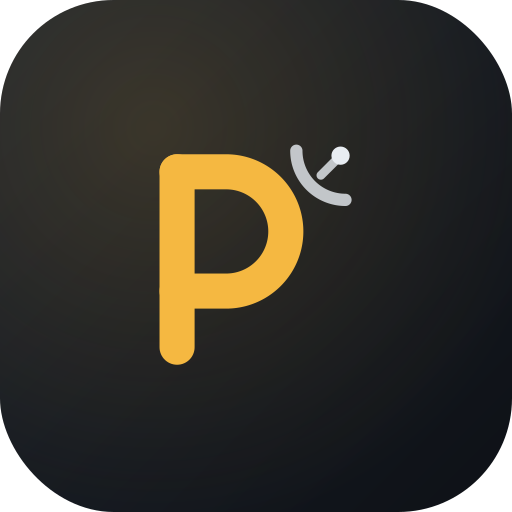
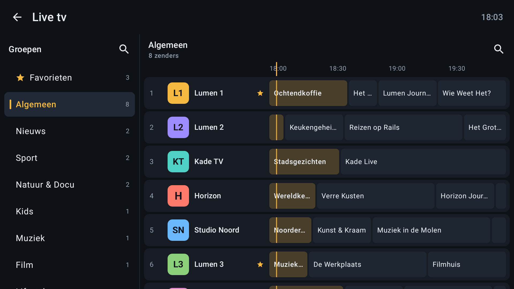
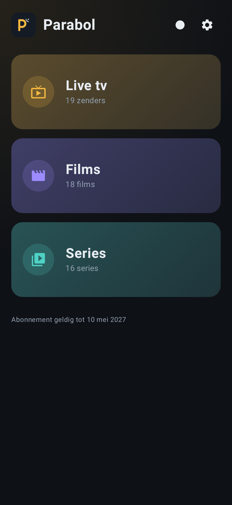

  

<h1 align="center">Parabol</h1>

Mediaspeler voor Android, Google TV, Windows en macOS. Speelt live tv, films en series af van je eigen aanbieder.

> Parabol bevat geen zenders, films, series of afspeellijsten en is niet verbonden aan een aanbieder of omroep. Je hebt een eigen, geldig abonnement nodig.

| Tv | Telefoon |
|:---:|:---:|
|  |  |

Alle zenders, titels en afbeeldingen in de schermafbeeldingen zijn verzonnen.

## Functies

- Live tv met groepen en tv-gids, films en series
- Opnemen, terugkijken (als je aanbieder het ondersteunt) en verder kijken
- Favorieten, meerdere accounts, groepen kiezen per land
- Audio- en ondertitelsporen kiezen, eigen .srt-bestanden
- Bediening met afstandsbediening, toetsenbord en touch; Nederlands en Engels

## Downloaden

Op de [releasepagina](https://github.com/abouzaggaoui-oss/Parabol/releases):

- **Android en Google TV:** `Parabol-v<versie>.apk`
- **macOS:** `Parabol-Desktop-<versie>-macOS-AppleSilicon.dmg` of `…-Intel.dmg`. De eerste keer: rechtsklik › **Open**.
- **Windows:** `…-Windows-Setup.exe` of `…-Windows-Portable.exe`

## Proberen zonder abonnement

Log in met server-URL `demo`, gebruikersnaam `demo` en wachtwoord `demo`. Je ziet verzonnen zenders en een tv-gids; de video's zijn de open films van de [Blender Foundation](https://www.blender.org) (CC BY 3.0).

## Meer

[Wijzigingen](CHANGELOG.md) · [Privacy](PRIVACY.md) · [Desktopversie](desktop/README.md)

Gebouwd met Kotlin en Jetpack Compose (Android) en Electron (desktop).
