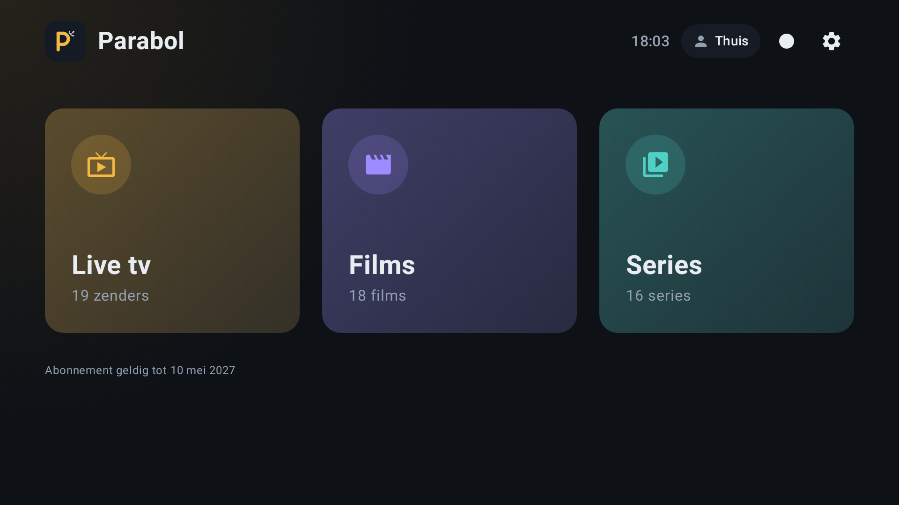
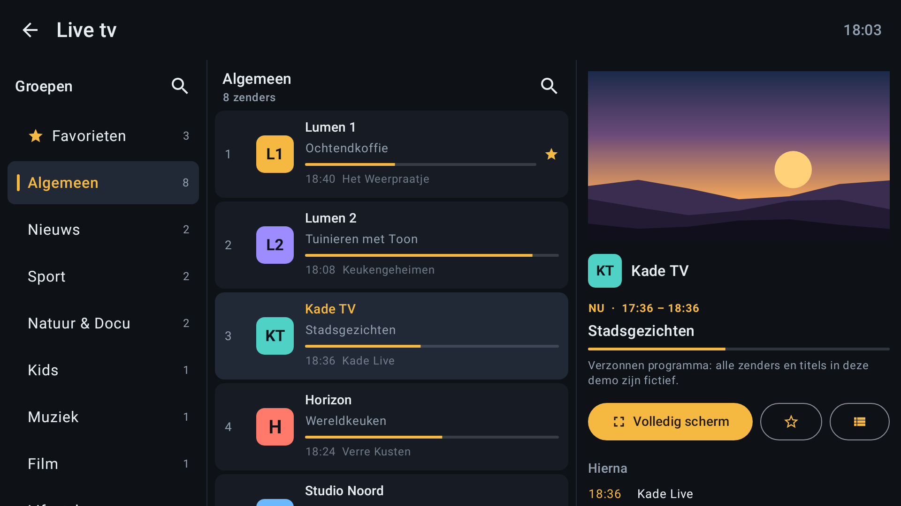
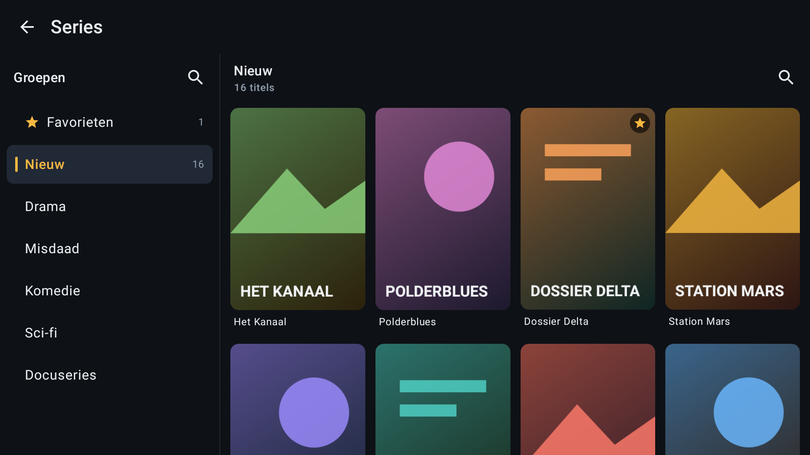
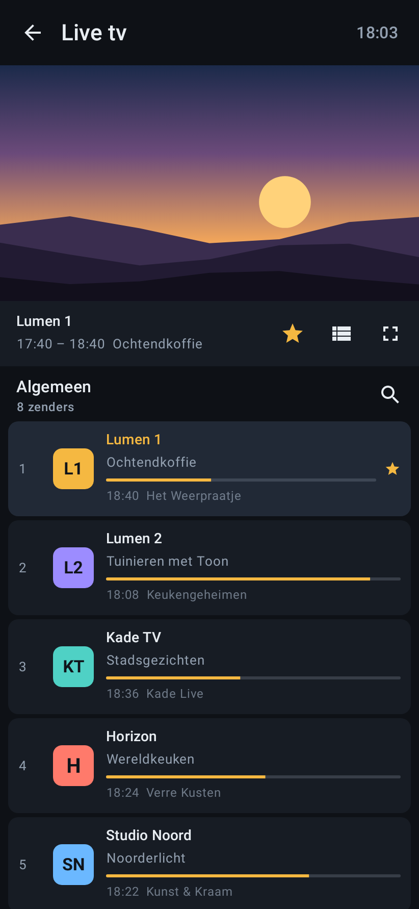
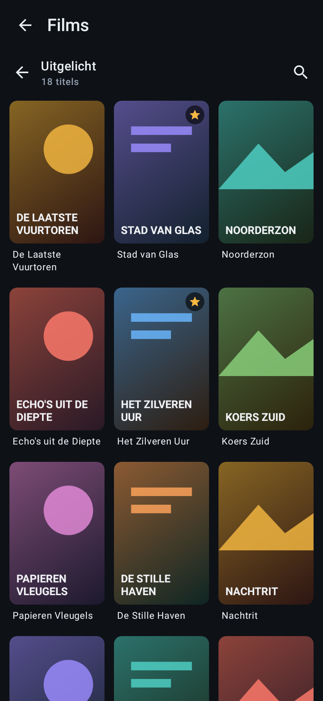

  

<h1 align="center">Parabol</h1>

Mediaspeler voor Android-telefoon, Google TV, Windows en macOS. Parabol speelt live tv, films en series af van de aanbieder waar je zelf een abonnement hebt, via de Xtream Codes API.

> **Parabol bevat geen zenders, films, series of afspeellijsten en verkoopt of verwijst niet naar abonnementen.** Je vult zelf de gegevens in van een dienst waarvoor je een geldig abonnement hebt. Parabol is niet verbonden aan een aanbieder of omroep.

## Zo ziet het eruit
**Op de tv**

| Home | Live tv met tv-gids |
|:---:|:---:|
|  |  |
| **Gedeeld scherm tijdens het kijken** | **Series** |
|  |  |

**Op de telefoon**

| Home | Live tv | Films |
|:---:|:---:|:---:|
|  |  |  |

> Alle zenders, programma's, titels, logo's en posters in deze afbeeldingen zijn verzonnen en speciaal voor de demo gegenereerd.(`./gradlew :app:recordRoborazziDebug`).

**Functies**

Wat er per versie veranderde, staat in [CHANGELOG.md](CHANGELOG.md).

- Inloggen met Xtream server-URL, gebruikersnaam en wachtwoord
- Live tv met categorieën (groepen)
- Zoeken in groepen en binnen een groep, bij live tv, films en series
- Vorige/volgende zender in de speler (knoppen, of channel up/down op de afstandsbediening)
- LIVE-indicator in de speler bij live kanalen
- Audio- en ondertitelspoor kiezen in de speler (CC-knop); eigen SRT/VTT-ondertitelbestand laden bij films en series
- Groepen beheren in Instellingen: per land in één keer aan/uit, of per groep
- Opnemen en terugkijken (als je aanbieder dat ondersteunt), meerdere accounts
- Films (VOD) en series met seizoenen en afleveringen
- Favorieten: tik op het hartje of houd een item lang ingedrukt
- Tv-gids: "Nu"-programma in de kanaallijst + volledige gids per kanaal (info-knop)
- Zoeken binnen elke lijst
- Interface in het Nederlands en Engels (volgt automatisch de systeemtaal)
- Live-streamformaat wisselbaar (HLS `.m3u8` of MPEG-TS `.ts`) voor maximale compatibiliteit

---

## Parabol op de computer (macOS en Windows)

Naast de Android-app is er een desktopversie (map `desktop/`, gebouwd met Electron) met dezelfde opzet en functies als Android v2.2.0: Home, Live tv met tv-gids-tijdlijn en gedeeld scherm, Films, Series, opnemen, terugkijken en Groepen beheren. Download de nieuwste via de release **Parabol Desktop** op de [releasepagina](https://github.com/abouzaggaoui-oss/Parabol/releases):

- **macOS** (Intel en Apple Silicon): `Parabol-Desktop-<versie>-macOS.dmg`. Open het bestand en sleep Parabol naar de map Apps.
  De app is niet bij Apple geregistreerd (daarvoor is een betaald ontwikkelaarsaccount nodig). De eerste keer openen gaat daarom zo: rechtsklik op Parabol › **Open** › **Open**. Zie je alleen "Verplaats naar prullenmand", ga dan naar **Systeeminstellingen › Privacy en beveiliging** en klik onderaan op **Toch openen**. Daarna start Parabol gewoon met een dubbelklik.
- **Windows**: `…-Windows-Setup.exe` (installer) of `…-Windows-Portable.exe` (zonder installatie).

Opnames staan op de Mac in **Films/Parabol**, op Windows in **Video's/Parabol**. Sluit je het venster, dan blijft Parabol actief (menubalk op de Mac, systeemvak op Windows) zodat opnames doorlopen; volledig afsluiten met Cmd+Q of via het icoon › Afsluiten.

## Downloaden

De nieuwste APK staat op de [releasepagina](https://github.com/abouzaggaoui-oss/Parabol/releases) (`Parabol-v<versie>.apk`), samen met het App Bundle-bestand (`.aab`) voor Google Play. Elke versie wordt automatisch gebouwd en ondertekend met dezelfde sleutel, zodat updates over de bestaande installatie heen gaan.

## Zelf bouwen

Open de map in Android Studio, of bouw vanaf de opdrachtregel met `./gradlew assembleDebug`. De APK staat daarna in `app/build/outputs/apk/debug/`.

## Installeren

**Op je Android-telefoon**

1. Kopieer de APK naar je telefoon (USB, cloud of stuur hem naar jezelf).
2. Open het bestand en sta "installeren uit onbekende bronnen" toe wanneer daarom wordt gevraagd.

**Op je Google TV**

1. Installeer de app *Downloader* uit de Play Store op de tv en open daarin de link naar de APK, of stuur de APK met een bestandsbeheerder (bijv. *Send Files to TV*) naar de tv.
2. Open de APK op de tv en installeer. Sta zo nodig "onbekende apps installeren" toe voor de bestandsbeheerder (Instellingen → Apps → Beveiliging en beperkingen).

Parabol verschijnt daarna gewoon in het app-overzicht van Google TV (leanback launcher wordt ondersteund).

## Gebruik

1. Start de app en vul in: server-URL (bijv. `http://server.voorbeeld.com:8080`), gebruikersnaam en wachtwoord. `http://` wordt automatisch toegevoegd als je het weglaat.
2. **Live tv**: tik op een groep → tik op een kanaal om af te spelen. Info-knop = tv-gids, hartje of lang indrukken = favoriet.
3. **Films/Series**: posterweergave per groep. Bij series kies je seizoen en aflevering.
4. **Groepen kiezen**: Instellingen → Groepen beheren.
5. **Eerst proberen zonder abonnement?** Log in met server-URL `demo`, gebruikersnaam `demo` en wachtwoord `demo`. Je ziet dan verzonnen zenders en een tv-gids; de video's zijn de open films van de [Blender Foundation](https://www.blender.org) (CC BY 3.0).
6. **Speelt live tv niet af?** Wissel in Instellingen het streamformaat van HLS naar MPEG-TS (of andersom).

## Technisch

- Kotlin + Jetpack Compose (één codebase voor telefoon en TV, D-pad-navigatie werkt)
- Media3/ExoPlayer voor afspelen (HLS, TS, MP4, MKV)
- Retrofit + Gson voor de Xtream Codes API (`player_api.php`)
- Favorieten en verborgen groepen lokaal opgeslagen (SharedPreferences)
- Min. Android 6.0 (API 23), target Android 16 (API 36)

## Privacy

Parabol verzamelt geen gegevens en heeft geen advertenties of analytics. Je inloggegevens en voorkeuren blijven op je apparaat; de app maakt alleen verbinding met de server die je zelf invult. Zie [PRIVACY.md](PRIVACY.md).

## Disclaimer

Parabol is alleen een speler. Je hebt een eigen, geldig abonnement nodig bij een aanbieder die de Xtream Codes API gebruikt. De app levert zelf geen content, en je bent zelf verantwoordelijk voor wat je ermee afspeelt.

Het Parabol-logo is eigen werk. De naam in de tv-banner is gezet in [Inter](https://rsms.me/inter/) (SIL Open Font License). Bronbestanden van het logo staan in `docs/brand`.
